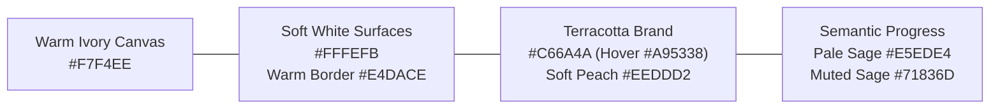
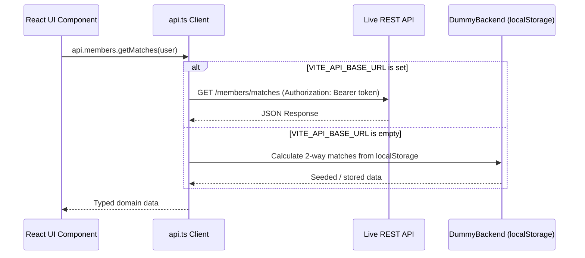

# SkillSwap — Project Overview & Architecture

## 1. Executive Summary

**SkillSwap** is a peer-to-peer, 100% non-monetary skill exchange web platform. Members share deep domain craft they have already mastered in return for learning desired skills directly from peers. There are no monetary fees, currency tokens, or paid subscriptions. The platform is driven by **strict 1:1 reciprocal exchange**:
> *"Mastery swapped, not bought. Trade what you know for what you don't."*

This repository houses the **production-grade frontend web application**. It is built as a complete, direct-to-backend frontend—not a mock prototype:
- All prototype/demo persona switcher shortcuts have been retired from the primary user interface.
- Includes full authentication screens (`/login` and `/signup`) with real validation and onboarding skill capture.
- Features a dual-mode API client layer ([`src/services/api.ts`](file:///e:/skillSwap/src/services/api.ts)) that connects seamlessly to any REST API backend via `VITE_API_BASE_URL`, while retaining an autonomous `localStorage` persistence engine ([`src/services/dummyBackend.ts`](file:///e:/skillSwap/src/services/dummyBackend.ts)) when running offline.

---

## 2. Technology Stack

| Layer | Technology | Specification / Purpose |
| :--- | :--- | :--- |
| **Framework** | React 18.3+ | Functional components, hooks, React Context for state management |
| **Tooling & Bundler** | Vite 6.0+ | Instant HMR, optimized production builds (333kB JS, 38kB CSS) |
| **Language** | TypeScript 5.6+ | Strict type safety for all domain entities, requests, and responses |
| **Styling** | Tailwind CSS 3.4+ | Custom color tokens, gradients, dark-mode canvas, responsive grid |
| **Typography** | Plus Jakarta Sans | High-legibility editorial sans-serif (weights 400 to 900) |
| **Icons** | Lucide React | Clean, minimalist, restrained icon set |
| **Architecture** | Decoupled API Client | Abstracted service layer connecting directly to REST endpoints |

---

## 3. Design System & Visual Hierarchy

The platform features a **Warm Minimalist, Professional SaaS, Human-centered** visual identity inspired by high-quality editorial websites:

### 3.1 Color Palette & Token Roles



1. **Base Surfaces**:
   - **Warm Ivory (`#F7F4EE`)**: The dominant canvas background across all pages, creating visual calm and reducing fatigue.
   - **Soft White (`#FFFEFB`)**: Elevated cards, navigation header, dropdowns, and modal dialogs with a 1px Warm Border (`#E4DACE`).
   - **Sand Beige (`#EFE9DF`)**: Secondary panels, sub-section groupings, and tab containers.
2. **Brand & Actions**:
   - **Terracotta (`#C66A4A`)**: The primary brand accent and CTA fill (10px border radius, subtle hover transition to Burnt Clay `#A95338`).
   - **Soft Peach (`#EEDDD2`)**: Skill chips, match highlights, and active navigation indicators.
3. **Supporting & Semantic Colors**:
   - **Pale Sage (`#E5EDE4`) & Muted Sage (`#71836D`)**: Positive reciprocal match badges, confirmed session states, and verified reciprocal indicators.
   - **Muted Gold (`#D6A75D`)**: Community star ratings, reviews, and small achievement details.
   - **Charcoal (`#292A27`)**: Main page headings and primary typography.
   - **Warm Grey (`#716D66`)**: Body text, descriptions, captions, and secondary labels.

### 3.2 Visual Hierarchy & Component Guidelines
- **Navigation**: Soft White background, subtle bottom border (`#E4DACE`), Charcoal brand and menu labels, Terracotta logo accent, and clean action buttons.
- **Hero & Landing Layout**:
  - **Left (7 cols)**: Restrained editorial statement typography (`Mastery swapped, not bought.`), concise value proposition, dual action buttons, and trust guarantees.
  - **Right (5 cols)**: Interactive **Live Reciprocal Match Engine** simulator previewing two-way compatibility calculation in real time.
- **Curated Specialists Showcase**: 3-column real photography cards showcasing real specialists (Design Systems, Engineering & Data, Languages & Strategy) with Muted Gold ratings and reciprocal tags.
- **3-Step Exchange Protocol**: Soft White cards with clean Terracotta numbers (`01`, `02`, `03`) explaining profile publication, two-way matching, and 1:1 session execution.
- **Closing Banner**: Restrained Warm Beige container with Charcoal headline and direct Terracotta action button.

---

## 4. Codebase Directory Structure

```
skillSwap/
├── docs/                                # Technical & API Documentation
│   ├── README.md                        # Documentation index
│   ├── 01_PROJECT_OVERVIEW.md           # Architecture, tech stack, design system
│   ├── 02_PAGES_AND_FEATURES.md         # Detailed page-by-page functional report
│   ├── 03_API_SPECIFICATION.md          # Complete REST API contracts & JSON schemas
│   ├── 04_BACKEND_INTEGRATION_GUIDE.md  # 30-second guide to connect live backend
│   └── 05_DEMO_WALKTHROUGH.md           # End-to-end user journey verification script
├── src/
│   ├── components/
│   │   ├── layout/                      # Navbar (floating capsule), Footer
│   │   ├── matches/                     # MatchCard, CompatibilityBadge, RequestSessionModal
│   │   ├── profile/                     # SkillTag, SkillModal
│   │   ├── sessions/                    # SessionCard, SessionDetailModal, ReviewModal
│   │   └── ui/                          # shadcn-style Button, Input, Textarea, Badge, Modal, Tabs, Avatar
│   ├── context/
│   │   ├── AuthContext.tsx              # Auth state provider, JWT lifecycle, login/signup/logout
│   │   └── NotificationContext.tsx      # Global toast alerts & banner notification state
│   ├── pages/
│   │   ├── LandingPage.tsx              # Editorial showcase, simulator, curated specialists, protocol
│   │   ├── LoginPage.tsx                # Production authentication form with validation
│   │   ├── SignupPage.tsx               # Member registration with initial skill capture
│   │   ├── DashboardPage.tsx            # Personal command center, stats, action alerts, matches
│   │   ├── FindMatchesPage.tsx          # Reciprocal discovery with search and multi-facet filters
│   │   ├── MemberProfilePage.tsx        # In-depth peer profile, skills, verified peer reviews
│   │   ├── SessionsPage.tsx             # Tabbed sessions (Pending, Confirmed, Completed, Archived)
│   │   ├── MyProfilePage.tsx            # Self-service profile, teach/learn skills manager, availability
│   │   └── NotificationsPage.tsx        # Real-time exchange alerts and status log
│   ├── services/
│   │   ├── api.ts                       # Unified API client (auto-switches to REST via VITE_API_BASE_URL)
│   │   ├── dummyBackend.ts              # In-browser localStorage engine for offline evaluation
│   │   └── mockData.ts                  # Seed data with realistic members, skills, reviews, sessions
│   ├── types/
│   │   └── index.ts                     # Strict TypeScript definitions for all domain models
│   ├── App.tsx                          # Router, view orchestrator, and top-level layout
│   ├── index.css                        # Tailwind directives, body canvas gradient, scrollbars
│   ├── main.tsx                         # React 18 DOM mount point
│   └── vite-env.d.ts                    # Vite client types & environment variables
├── index.html                           # App HTML shell with Google Fonts
├── package.json                         # Dependencies and build scripts
├── tailwind.config.js                   # Color system, custom gradients, shadows, fonts
├── tsconfig.json                        # TypeScript strict compiler configuration
└── vite.config.ts                       # Vite bundler configuration (port 3000)
```

---

## 5. Network Layer Architecture

The frontend is architecturally decoupled from any specific backend implementation:



To switch to a live server, backend engineers only need to set `VITE_API_BASE_URL` in `.env`. No frontend component code requires changes.
