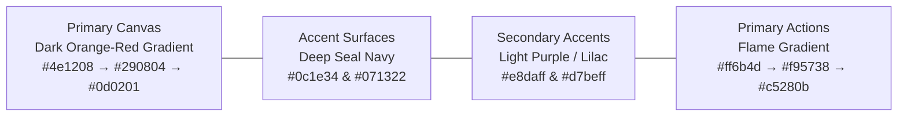
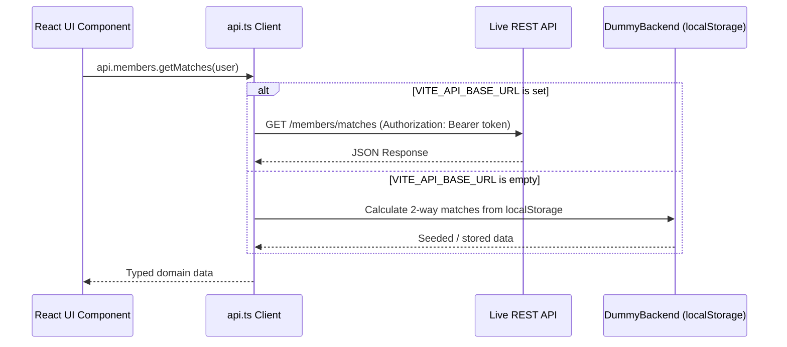

# SkillSwap — Project Overview & Architecture

## 1. Executive Summary

**SkillSwap** is a peer-to-peer, 100% non-monetary skill exchange web platform. Members share deep domain craft they have already mastered in return for learning desired skills directly from peers. There are no monetary fees, currency tokens, or paid subscriptions. The platform is driven by **strict 1:1 reciprocal exchange**:
> *"Mastery swapped, not bought. Trade what you know for what you don't."*

This repository houses the **production-grade frontend web application**. It is built as a complete, direct-to-backend frontend—not a mock prototype:
- All prototype/demo persona switcher shortcuts have been retired from the primary user interface.
- Includes full authentication screens (`/login` and `/signup`) with real validation and onboarding skill capture.
- Features a dual-mode API client layer ([`src/services/api.ts`](file:///e:/skillSwap/src/services/api.ts)) that connects seamlessly to any REST API backend via `VITE_API_BASE_URL`, while retaining an autonomous `localStorage` persistence engine ([`src/services/dummyBackend.ts`](file:///e:/skillSwap/src/services/dummyBackend.ts)) when running offline.

---

## 2. Technology Stack

| Layer | Technology | Specification / Purpose |
| :--- | :--- | :--- |
| **Framework** | React 18.3+ | Functional components, hooks, React Context for state management |
| **Tooling & Bundler** | Vite 6.0+ | Instant HMR, optimized production builds (333kB JS, 38kB CSS) |
| **Language** | TypeScript 5.6+ | Strict type safety for all domain entities, requests, and responses |
| **Styling** | Tailwind CSS 3.4+ | Custom color tokens, gradients, dark-mode canvas, responsive grid |
| **Typography** | Plus Jakarta Sans | High-legibility editorial sans-serif (weights 400 to 900) |
| **Icons** | Lucide React | Clean, minimalist, restrained icon set |
| **Architecture** | Decoupled API Client | Abstracted service layer connecting directly to REST endpoints |

---

## 3. Design System & Visual Hierarchy

The platform features a bold visual design based on the specified color palette and editorial layouts:

### 3.1 Color Palette & Token Roles



1. **Primary Color (Dark Orange-Reddish Gradient on Canvas)**:
   - Applied directly to the `<body>` canvas:
     `radial-gradient(ellipse at 50% -15%, #4e1208 0%, #290804 42%, #120302 80%, #070101 100%)`
   - Paired with vibrant flame action accents (`#ff6b4d` to `#ea3a18` to `#c5280b`) for primary buttons, brand emblems, and title highlights.
2. **Secondary Color (Light Purple / Soft Lilac)**:
   - Hex codes: `#faf7ff`, `#f3ebff`, `#e8daff`, `#d7beff`.
   - Used for reciprocal compatibility score badges (`99% Reciprocal Fit`), category pills, status borders, and subtle glowing tag highlights.
3. **Accent Color (Deep Seal Blue / Navy)**:
   - Hex codes: `#0c1e34`, `#071322`, `#142842`.
   - Used for all major card surfaces, floating capsule header, modal dialogs, and structured containers (`bg-[#0c1e34]/90 backdrop-blur-md border border-lilac-300/20`).
4. **Legibility & High Contrast**:
   - Zero low-contrast white-on-white text.
   - Headings are crisp white (`text-white`) with high-contrast flame gradients.
   - Body copy and labels are clear light lilac and off-white (`text-lilac-100`, `text-lilac-200/80`), guaranteeing 7:1+ contrast on dark surfaces.

### 3.2 Visual Positioning (QuantraLogic & T. Edwards Layouts)
- **Floating Top Capsule Navbar**: Frosted Navy capsule centered at the top containing brand logo, route pills (`Overview`, `Explore Skills`, `How It Works`), and auth actions.
- **Asymmetric Hero Layout**:
  - **Left (7 cols)**: Massive defining uppercase statement typography (`MASTERY SWAPPED, NOT BOUGHT.`), value proposition paragraph, dual CTA buttons, and trust guarantees.
  - **Right (5 cols)**: Interactive **Live Reciprocal Match Engine** preview card allowing visitors to select teach/learn crafts and instantly see two-way fit calculation.
- **Curated Specialists Showcase**: 3-column real photography cards showcasing real specialists (Elena Rostova in Design Systems, Marcus Vance in Distributed Data, Sofia Morales in Languages & UX) with 5.0 ratings and exchange tags.
- **3-Step Exchange Protocol**: 3 navy cards with oversized flame numbers (`01`, `02`, `03`) explaining profile publication, two-way matching, and 1:1 session execution.
- **Bold Closing Banner**: Multi-tone gradient banner with direct calls to action.

---

## 4. Codebase Directory Structure

```
skillSwap/
├── docs/                                # Technical & API Documentation
│   ├── README.md                        # Documentation index
│   ├── 01_PROJECT_OVERVIEW.md           # Architecture, tech stack, design system
│   ├── 02_PAGES_AND_FEATURES.md         # Detailed page-by-page functional report
│   ├── 03_API_SPECIFICATION.md          # Complete REST API contracts & JSON schemas
│   ├── 04_BACKEND_INTEGRATION_GUIDE.md  # 30-second guide to connect live backend
│   └── 05_DEMO_WALKTHROUGH.md           # End-to-end user journey verification script
├── src/
│   ├── components/
│   │   ├── layout/                      # Navbar (floating capsule), Footer
│   │   ├── matches/                     # MatchCard, CompatibilityBadge, RequestSessionModal
│   │   ├── profile/                     # SkillTag, SkillModal
│   │   ├── sessions/                    # SessionCard, SessionDetailModal, ReviewModal
│   │   └── ui/                          # shadcn-style Button, Input, Textarea, Badge, Modal, Tabs, Avatar
│   ├── context/
│   │   ├── AuthContext.tsx              # Auth state provider, JWT lifecycle, login/signup/logout
│   │   └── NotificationContext.tsx      # Global toast alerts & banner notification state
│   ├── pages/
│   │   ├── LandingPage.tsx              # Editorial showcase, simulator, curated specialists, protocol
│   │   ├── LoginPage.tsx                # Production authentication form with validation
│   │   ├── SignupPage.tsx               # Member registration with initial skill capture
│   │   ├── DashboardPage.tsx            # Personal command center, stats, action alerts, matches
│   │   ├── FindMatchesPage.tsx          # Reciprocal discovery with search and multi-facet filters
│   │   ├── MemberProfilePage.tsx        # In-depth peer profile, skills, verified peer reviews
│   │   ├── SessionsPage.tsx             # Tabbed sessions (Pending, Confirmed, Completed, Archived)
│   │   ├── MyProfilePage.tsx            # Self-service profile, teach/learn skills manager, availability
│   │   └── NotificationsPage.tsx        # Real-time exchange alerts and status log
│   ├── services/
│   │   ├── api.ts                       # Unified API client (auto-switches to REST via VITE_API_BASE_URL)
│   │   ├── dummyBackend.ts              # In-browser localStorage engine for offline evaluation
│   │   └── mockData.ts                  # Seed data with realistic members, skills, reviews, sessions
│   ├── types/
│   │   └── index.ts                     # Strict TypeScript definitions for all domain models
│   ├── App.tsx                          # Router, view orchestrator, and top-level layout
│   ├── index.css                        # Tailwind directives, body canvas gradient, scrollbars
│   ├── main.tsx                         # React 18 DOM mount point
│   └── vite-env.d.ts                    # Vite client types & environment variables
├── index.html                           # App HTML shell with Google Fonts
├── package.json                         # Dependencies and build scripts
├── tailwind.config.js                   # Color system, custom gradients, shadows, fonts
├── tsconfig.json                        # TypeScript strict compiler configuration
└── vite.config.ts                       # Vite bundler configuration (port 3000)
```

---

## 5. Network Layer Architecture

The frontend is architecturally decoupled from any specific backend implementation:



To switch to a live server, backend engineers only need to set `VITE_API_BASE_URL` in `.env`. No frontend component code requires changes.
