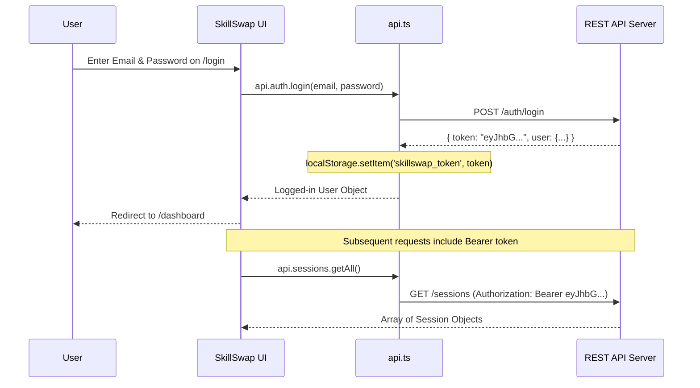
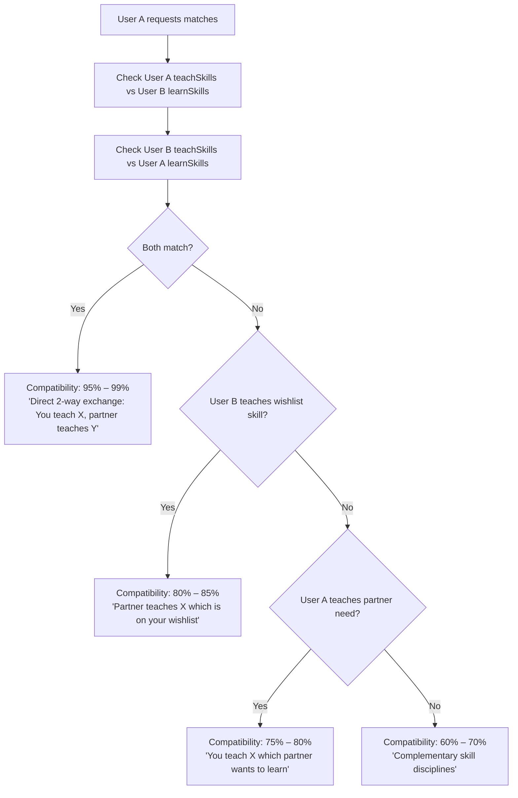

# SkillSwap — Backend Integration Guide

This guide walks backend engineers through connecting any REST API backend directly to the SkillSwap frontend application.

---

## 1. Quick Connection Setup (30 Seconds)

1. Create a `.env` file in the project root (copy from `.env.example`):
   ```bash
   cp .env.example .env
   ```
2. Populate `VITE_API_BASE_URL` with your server's endpoint prefix:
   ```env
   VITE_API_BASE_URL=http://localhost:8000/api
   ```
3. Restart or start the Vite development server:
   ```bash
   npm run dev
   ```

When `VITE_API_BASE_URL` is populated, [`src/services/api.ts`](file:///e:/skillSwap/src/services/api.ts) automatically disables the offline browser engine and dispatches real HTTP `fetch()` requests directly to your backend server with JWT Bearer tokens.

---

## 2. Network Client Architecture

All network requests dispatched by the frontend are strictly centralized in **[`src/services/api.ts`](file:///e:/skillSwap/src/services/api.ts)**:

```typescript
// src/services/api.ts
const API_BASE_URL = import.meta.env.VITE_API_BASE_URL || '';

async function fetchClient<T>(endpoint: string, options: RequestInit = {}): Promise<T> {
  const token = localStorage.getItem('skillswap_token');
  const headers: Record<string, string> = {
    'Content-Type': 'application/json',
    ...(token ? { Authorization: `Bearer ${token}` } : {}),
    ...(options.headers as Record<string, string>),
  };

  const response = await fetch(`${API_BASE_URL}${endpoint}`, {
    ...options,
    headers,
  });

  if (!response.ok) {
    const errorData = await response.json().catch(() => ({}));
    throw new Error(errorData.message || `API error: ${response.status}`);
  }

  return response.json();
}
```

### Architectural Guarantees:
- **No Direct Fetch in UI**: Pages and components never interact with raw `fetch()` or `Axios` calls directly; they call strongly typed methods on the `api` object (e.g., `api.sessions.create()`, `api.members.getMatches()`).
- **Clean Fallback**: If `VITE_API_BASE_URL` is empty, the frontend routes calls to [`src/services/dummyBackend.ts`](file:///e:/skillSwap/src/services/dummyBackend.ts) using browser `localStorage` for offline development.

---

## 3. CORS Configuration Requirements

Your backend server must allow cross-origin requests from the SkillSwap frontend client.

### Permitted Origins
- **Development**: `http://localhost:3000` (and `http://127.0.0.1:3000`)
- **Production**: `https://your-production-domain.com`

### Permitted Headers & Methods
- **Headers**: `Content-Type`, `Authorization`, `Accept`
- **Methods**: `GET`, `POST`, `PUT`, `PATCH`, `DELETE`, `OPTIONS`

#### Express.js (Node / TypeScript):
```javascript
import cors from 'cors';

app.use(cors({
  origin: process.env.CLIENT_URL || 'http://localhost:3000',
  credentials: true,
  allowedHeaders: ['Content-Type', 'Authorization', 'Accept'],
  methods: ['GET', 'POST', 'PUT', 'PATCH', 'DELETE', 'OPTIONS']
}));
```

#### FastAPI (Python):
```python
from fastapi.middleware.cors import CORSMiddleware

app.add_middleware(
    CORSMiddleware,
    allow_origins=["http://localhost:3000"],
    allow_credentials=True,
    allow_methods=["*"],
    allow_headers=["*"],
)
```

#### Django (Python):
```python
# settings.py
INSTALLED_APPS += ['corsheaders']
MIDDLEWARE = ['corsheaders.middleware.CorsMiddleware', ...] + MIDDLEWARE
CORS_ALLOWED_ORIGINS = ["http://localhost:3000"]
CORS_ALLOW_HEADERS = ['content-type', 'authorization', 'accept']
```

---

## 4. Token & Authentication Lifecycle



- **Token Storage**: On `/auth/login` or `/auth/signup`, the frontend stores the returned token string in `localStorage.setItem('skillswap_token', token)`.
- **Automatic Header Injection**: Every subsequent call automatically sends `Authorization: Bearer <token>`.
- **Session Invalidation (401)**: If a request fails with `401 Unauthorized`, `api.auth.getCurrentUser()` catches the error, clears local authentication state, and redirects the user to the `/login` screen.

---

## 5. Reciprocal Matching Calculation Formula

When implementing `GET /members/matches` on your backend, follow this recommended scoring formula to achieve mutual two-way pairing:



1. **Direct Two-Way Reciprocal Match (`Score: 95% – 99%`)**:
   - Condition: User A teaches at least one skill in User B's wishlist **AND** User B teaches at least one skill in User A's wishlist.
   - Compatibility Reason: `"Direct 2-way exchange: You can teach [Skill A], and [Partner] can teach you [Skill B]."`
2. **One-Way Need Match (`Score: 80% – 85%`)**:
   - Condition: User B teaches a skill on User A's wishlist.
   - Compatibility Reason: `"[Partner] teaches [Skill B] which is on your wishlist."`
3. **One-Way Offer Match (`Score: 75% – 80%`)**:
   - Condition: User A teaches a skill on User B's wishlist.
   - Compatibility Reason: `"You can teach [Skill A] which [Partner] wants to learn."`
4. **Discipline Affinity (`Score: 60% – 70%`)**:
   - Condition: Complementary disciplines (e.g. Design + Frontend Engineering).

---

## 6. Pre-Flight Integration Checklist

- [ ] `.env` file created with `VITE_API_BASE_URL` pointing to backend (e.g., `http://localhost:8000/api`).
- [ ] CORS middleware configured to accept `http://localhost:3000` with headers `Authorization, Content-Type, Accept`.
- [ ] `/auth/login` and `/auth/signup` returning `{ token: string, user: User }`.
- [ ] `/auth/me` returning current authenticated `User` object or 401 when unauthenticated.
- [ ] `/members` and `/members/matches` filtering out profiles with `visibility: "paused"`.
- [ ] `/sessions` handling status transitions: `pending` → `confirmed` / `rescheduled` / `declined` / `completed`.
- [ ] `/reviews` endpoint verifying session completion and strictly preventing duplicate reviews for the same `sessionId`.
- [ ] Real-time or polled `/notifications` dispatching alerts on status changes.
